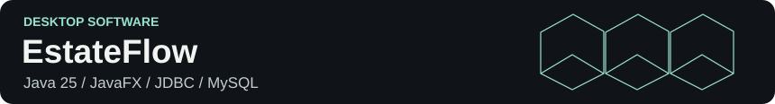
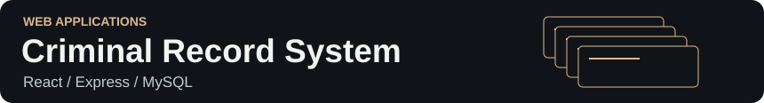
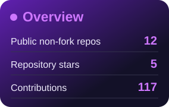
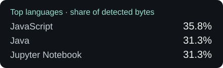
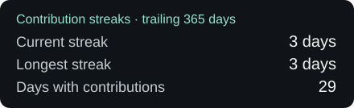

I’m Tarang, a computer science student. I like building things I can put in someone’s hands, whether that’s a campus lunch order or a way to hear which species are calling in a noisy recording.

  

## Selected work

Listen to a field recording five seconds at a time and inspect overlapping species calls. The historical, duplicate-cleaned audit reported **76.054% window accuracy** across 4,269 recordings. The case study includes misses on later field clips.

[Case study and evaluation](https://github.com/Tarang06go/Tarang06go/tree/main/wildlife-ai-studio) · [44-second recorded demo](https://github.com/Tarang06go/Tarang06go/blob/main/wildlife-ai-studio/unified-v1.2.mp4) · [Example audio](https://github.com/Tarang06go/Tarang06go/tree/main/wildlife-ai-studio/demos)

Students order lunch from their phones. The campus shop manages the menu and incoming orders from one dashboard.

[Repository](https://github.com/Tarang06go/wrapchik-deployment) · [Deployment guide](https://github.com/Tarang06go/wrapchik-deployment/blob/master/DEPLOYMENT.md) · [Web demo](https://wrapchik-web-z7ur.onrender.com)

How many flight cycles does a turbofan have left? An LSTM trained on NASA C-MAPSS sensor data scored **11.41 cycles RMSE** in the saved experiment.

[Repository and results](https://github.com/Tarang06go/Jet-Engine-RUL-Prediction) · [Executed notebook](https://github.com/Tarang06go/Jet-Engine-RUL-Prediction/blob/main/turbofan_rul_prediction.ipynb)

A JavaFX property-management desktop app with an audit trail, ordered MySQL migrations and a documented Windows install and recovery process.

[Repository](https://github.com/Tarang06go/EstateFlow) · [Release and backup guide](https://github.com/Tarang06go/EstateFlow/blob/master/docs/RELEASE_AND_BACKUP.md)

A role-based workspace for case status, officer assignments and criminal profiles, backed by Express and MySQL.

[Repository and setup](https://github.com/Tarang06go/criminal-record-system) · [Web demo](https://criminal-record-system.vercel.app)

## Tools I build with

 

 

 

## On GitHub

  

Language shares cover public, owned, non-fork repositories. Activity and streaks cover the last 365 calendar days.

[Explore my contribution history →](https://github.com/Tarang06go?tab=overview#js-contribution-activity)

