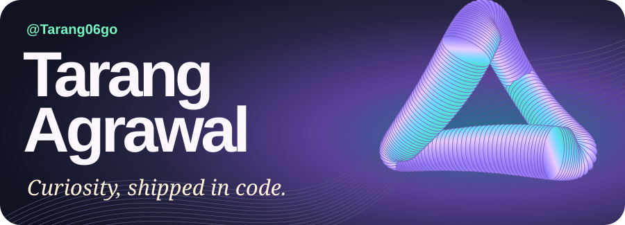
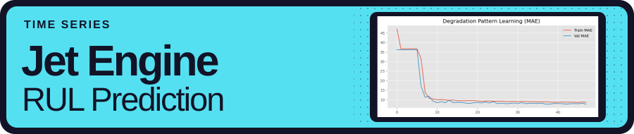
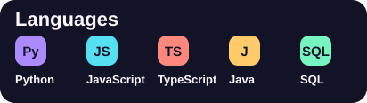
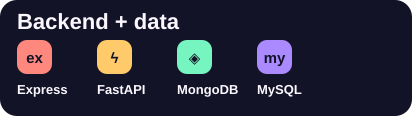

I’m a computer science student working across **software engineering, cloud systems and applied AI**. My projects range from mobile ordering and database-backed desktop tools to models that interpret field recordings and engine sensor data.

[LinkedIn](https://www.linkedin.com/in/tarang-agrawal-19774b2a9/) · [Kaggle](https://www.kaggle.com/tarang02agrawal) · [Instagram](https://www.instagram.com/tarangunlocked/)

## Selected projects

Explore a field recording in five-second windows, listen to possible overlapping callers and export the evidence. The historical duplicate-cleaned evaluation reported **76.054% window accuracy** across 4,269 recordings. The case study also documents missed species on later field clips.

[Case study and evaluation](https://github.com/Tarang06go/Tarang06go/tree/main/wildlife-ai-studio) · [44-second recorded demo](https://github.com/Tarang06go/Tarang06go/blob/main/wildlife-ai-studio/unified-v1.2.mp4) · [Example audio](https://github.com/Tarang06go/Tarang06go/tree/main/wildlife-ai-studio/demos)

A campus food outlet can take orders from student phones and manage its menu and incoming orders from the shop dashboard. The deployment guide covers API readiness, mobile builds and update rollback.

[Repository](https://github.com/Tarang06go/wrapchik-deployment) · [Deployment guide](https://github.com/Tarang06go/wrapchik-deployment/blob/master/DEPLOYMENT.md) · [Web demo](https://wrapchik-web-z7ur.onrender.com)

An LSTM estimates how many flight cycles remain from turbofan sensor histories. The saved NASA C-MAPSS experiment reports **11.41 cycles RMSE**. The notebook also explores uncertainty with Monte Carlo dropout.

[Repository and results](https://github.com/Tarang06go/Jet-Engine-RUL-Prediction) · [Executed notebook](https://github.com/Tarang06go/Jet-Engine-RUL-Prediction/blob/main/turbofan_rul_prediction.ipynb)

A JavaFX desktop application for property management with audit history, ordered database migrations and Windows packaging. The release guide walks through a clean install and database recovery.

[Repository](https://github.com/Tarang06go/EstateFlow) · [Release and backup guide](https://github.com/Tarang06go/EstateFlow/blob/master/docs/RELEASE_AND_BACKUP.md)

Officers and administrators work with case status, officer assignments and criminal profiles through a role-based web interface backed by a REST API and MySQL.

[Repository and setup](https://github.com/Tarang06go/criminal-record-system) · [Web demo](https://criminal-record-system.vercel.app)

## Engineering toolkit

| Discipline | Technologies used in these projects |
| --- | --- |
|  **Languages** | Python · JavaScript · TypeScript · Java · SQL |
|  **Frontend and Mobile** | React · React Native · Expo · JavaFX |
|  **Backend and Databases** | Express · FastAPI · MongoDB · MySQL |
|  **AI and Machine Learning** | PyTorch · TensorFlow · Keras · Perch V2 |
|  **Cloud and Infrastructure** | Docker · Docker Compose · Render · Vercel |
|  **Developer Tools** | Git · GitHub Actions · Maven · Vite |

## GitHub activity

Language shares use public, owned, non-fork repositories. Streaks use the last 365 contribution-calendar days and allow today to finish in UTC.

[Contribution history](https://github.com/Tarang06go?tab=overview#js-contribution-activity)

