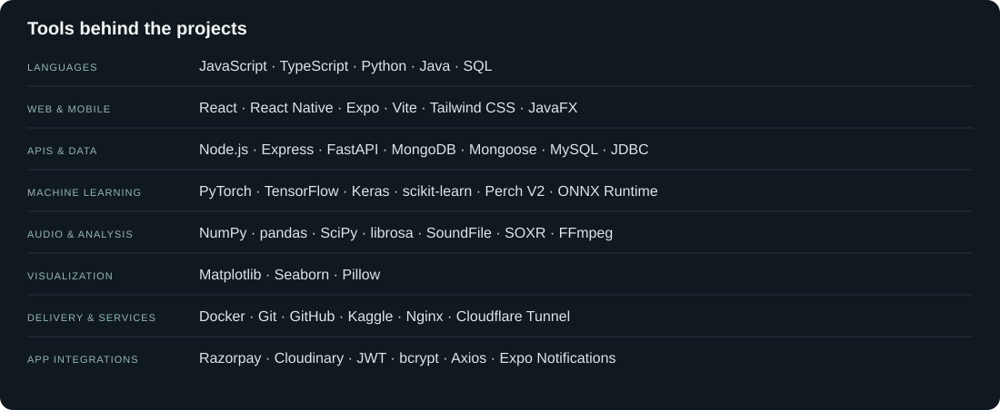

I build web and mobile applications, inference services, and machine learning tools for real-world problems.

&nbsp;
&nbsp;

I built **Wrapchik**, a campus food ordering and shop management application. Students can order from their phones, and the shopkeeper can manage the menu and incoming orders in one place.

[Explore the app and its architecture →](https://github.com/Tarang06go/ucs503p-202627odd-wrapchik/tree/master/code/wrapchik#readme)

## My tech stack

Full toolkit

## What I’ve built

### Wildlife AI Studio

Audio recognition with Perch V2, interactive species timelines and simultaneous alerts. **76.054% independent-window accuracy** on the duplicate-cleaned audit.

[See the project and recorded demo](./wildlife-ai-studio/README.md)

| Project | What it does | Core technologies |
| --- | --- | --- |
| [Wrapchik](https://github.com/Tarang06go/ucs503p-202627odd-wrapchik/tree/master/code/wrapchik) | Campus food ordering and shop management |  |
| [Wildlife AI Studio](./wildlife-ai-studio/README.md) | Field audio recognition and overlapping species detection |  |
| [EstateFlow](https://github.com/Tarang06go/EstateFlow) | **Java desktop application** for property records |  |
| [Jet Engine RUL](https://github.com/Tarang06go/Jet-Engine-RUL-Prediction) | Estimates remaining engine life from sensor data |  |
| [Criminal Record System](https://github.com/Tarang06go/criminal-record-system) | Searchable records and case management |  |

## Practice & research

## Contributions

[View recent contributions on GitHub →](https://github.com/Tarang06go?tab=overview#js-contribution-activity)
