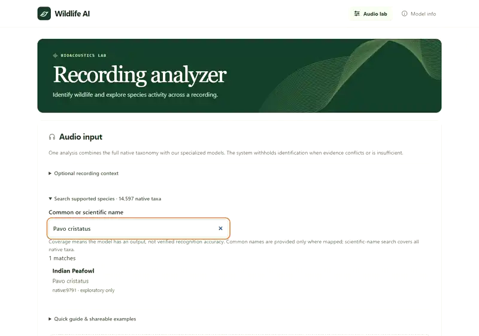

# Wildlife AI Studio

**One upload, automatic evidence, honest uncertainty.** A React/TypeScript and FastAPI bioacoustic dashboard combining frozen Perch V2 outputs with specialized focal and multi-label soundscape models. Search native taxa, inspect potential simultaneous callers, listen along a five-second timeline and export evidence.

[**Watch or download the 44-second demo**](unified-v1.2.mp4) · [Shareable example recordings and licenses](demos/README.md) · [Source and private release for authorized collaborators](https://github.com/Tarang06go/wildlife-ai-studio)

The silent video records the actual v1.2.0 interface: a licensed Indian Nightjar clip, a known annotated frog interval with four matching historical alerts, a difficult chorus, silence and an unsupported tone. One annotated frog species is missed. Private source audio is omitted. These are demonstrations, not independent accuracy evidence. The old [v1.0.3 recording](dashboard.mp4) is retained as an archive.

| Historical research benchmark | Result | Interpretation |
|---|---:|---|
| Duplicate-cleaned five-second accuracy | 76.054% | 32,114 windows, 4,269 recordings |
| Focal macro F1 | 0.64531 | Class-averaged measure |
| Recording-aware / recording-level accuracy | 93.153% / 91.052% | Different units using recording context |
| Calibrated pooled soundscape macro ROC-AUC | 0.87190 | 739 intervals, 66 historically exposed recordings, 75 evaluable species |

**External reality check:** a later frozen 43-file HTTPS stress test found unified recognition correct on 6/8 newly sourced exact-label species clips; Common Myna and field cricket were missed. Eleven negative-designated clips yielded no unified primary ID. A constructed three-target overlap retrieved only one target in the top three. These small convenience tests have unknown Perch pretraining overlap and do not establish universal field accuracy. The French pond still triggers a suspect historical frog alert marked for review. High AUC is not accuracy or deployed alert precision.

The app has 206 focal classes, 234 soundscape outputs and 14,597 native taxa. Only 15 soundscape classes have enabled historical thresholds. Native ranks and score percentiles are not presence probabilities. Suitable for assisted exploration, not autonomous wildlife inventory.

**Engineering:** frozen shared backbone outputs, conservative decision-level fusion, bounded FFmpeg decoding, CPU Docker deployment, recoverable concurrency, real browser verification, model checksums and auditable CSV/JSON exports. Google Research supplies Perch; Tarang and Amisha's research supplies the task-specific models and calibration.

[Temporary password-protected live dashboard](https://premises-elderly-registered-notebook.trycloudflare.com) — requires the owner's PC and Docker/tunnel running; its address can expire. **This recorded demo and these permitted audio downloads work independently of that tunnel.** No model weights, restricted datasets or viewer credentials are public.
