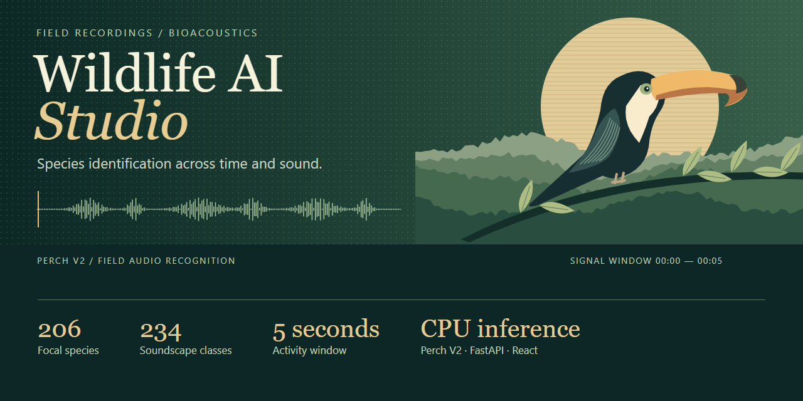

# Wildlife AI Studio

Field recordings rarely contain just one animal. I built a React and FastAPI dashboard that lets a listener identify a focal species and jump to the first five-second window that triggered each soundscape alert. Tarang and Amisha’s research supplied the trained models and calibration.

[Watch or download the silent MP4](dashboard.mp4) · [Source and release for authorized collaborators](https://github.com/Tarang06go/wildlife-ai-studio)

The first recording returns *Guyalna cuta*. The second has five annotated frog species in the same window. Four triggered alerts, and all four match the annotations. The video shows the running application using development examples.

| Measurement | Result |
| --- | ---: |
| Independent five-second top-one accuracy | 76.054% |
| Class-averaged focal F1 | 0.64531 |
| Recording-level accuracy | 91.052% |
| Calibrated pooled soundscape macro ROC-AUC | 0.87190 |
| Warm five-second request on Kaggle CPU | 0.74 s |

Focal metrics use 32,114 windows from 4,269 recordings after duplicate exclusion. The pooled soundscape evaluation covers 75 evaluable species across 66 recordings with previous research exposure. The app scores 234 soundscape classes, with automatic alerts enabled for 15. The CPU measurement covers decode, inference and response serialization. Historical recording-aware accuracy was 93.153% when predictions had access to the full recording.

**Built with** Python, Perch V2, ONNX Runtime, PyTorch, FastAPI, React, TypeScript and Docker. The portfolio recording remains available when the temporary live demo is offline.
